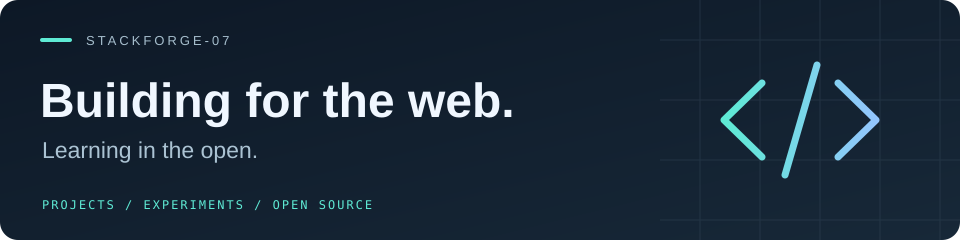

  

  <a href="#selected-projects">Projects</a> &nbsp; / &nbsp;
  <a href="#open-source">Open source</a> &nbsp; / &nbsp;
  <a href="https://github.com/Stackforge-07?tab=repositories">All repositories</a>

I build web projects and learn by reading, testing, and improving real code. My work spans browser games, web tools, and contributions to open-source projects.

### Selected projects

| Project | What to explore | Built with |
| :--- | :--- | :--- |
| **[SecureQR](https://github.com/Stackforge-07/Link-Qr)** | QR links with destination previews, expiration, and revocation. | TypeScript · Next.js · Prisma |
| **[SnakeGame](https://github.com/Stackforge-07/SnakeGame)** | A classic browser game built with JavaScript. [Play it →](https://stackforge-07.github.io/SnakeGame/) | JavaScript · HTML · CSS |
| **[StayNest — contribution fork](https://github.com/Stackforge-07/staynest)** | A place to explore and work on an open-source stay-booking app. [Original project →](https://github.com/vikas0799/staynest) | React · Node.js · MongoDB |

### Open source

I contribute through focused changes, regression tests, and review feedback.

**Merged contributions**  
[freeCodeCamp](https://github.com/freeCodeCamp/freeCodeCamp/pulls?q=is%3Apr+author%3AStackforge-07+is%3Amerged) &nbsp; · &nbsp;
[Kana Dojo](https://github.com/lingdojo/kana-dojo/pulls?q=is%3Apr+author%3AStackforge-07+is%3Amerged) &nbsp; · &nbsp;
[Library Management System](https://github.com/samarkumar4355/Library_Management_System/pulls?q=is%3Apr+author%3AStackforge-07+is%3Amerged)

**Other proposed changes**  
[Rocket.Chat: direct-message member counts](https://github.com/RocketChat/Rocket.Chat/pull/42711) &nbsp; · &nbsp;
[Submitty: table sorting](https://github.com/Submitty/Submitty/pull/13494)  
These links point to proposals; their current review and merge status is shown on GitHub.

### Tools & technologies

`JavaScript` `TypeScript` `React` `Next.js` `Node.js` `Express` `MongoDB` `Prisma` `Git`

---

Explore a project, try the code, or follow a pull request to see what I’m working on.
